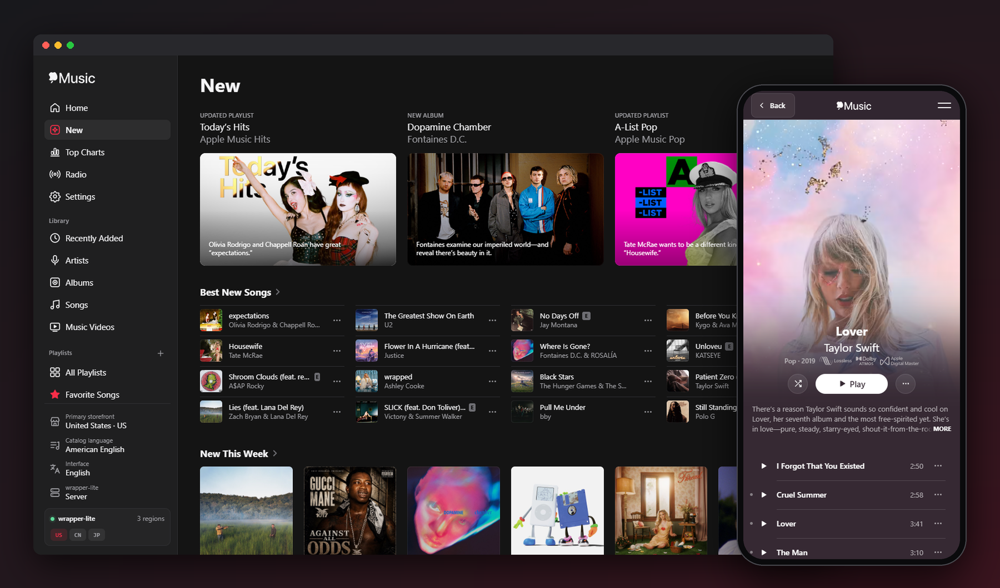
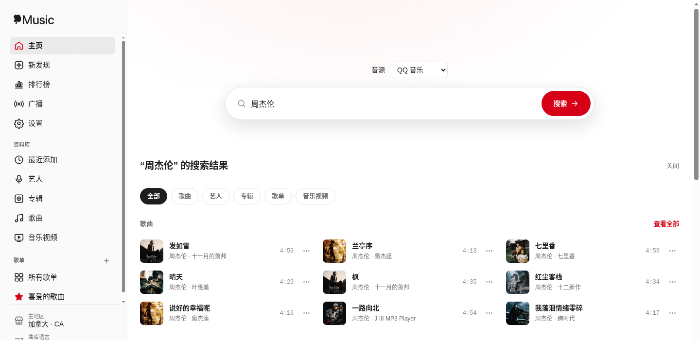
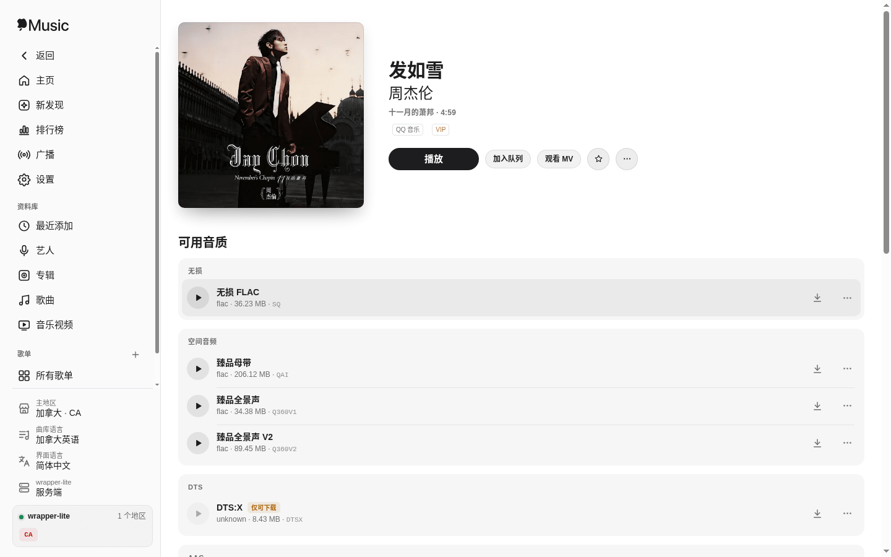
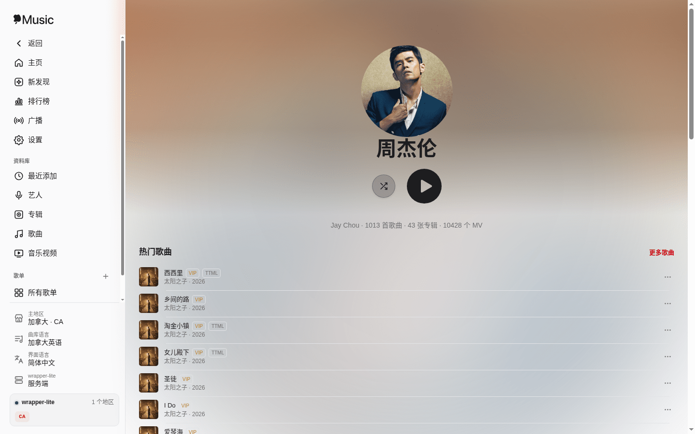

<div align="center">

# Fantastic

**A music web player in your browser: Apple Music and QQ Music in one player — lossless, Dolby Atmos and music videos, decrypted with WebAssembly.**

[](https://github.com/kid141252010/Fantastic/releases/latest)
[](https://github.com/kid141252010/Fantastic/actions/workflows/build-test.yml)
[](LICENSE)
[](https://t.me/apple_music_alac)
[](https://qun.qq.com/universal-share/share?ac=1&authKey=1ao3fc9n1aN4ese64QmDs6mOZgvdB7YfR1K9y0YncbQp1%2Bz61x3EKfMCROv9MHhv&busi_data=eyJncm91cENvZGUiOiI2NzgwMzg1NDgiLCJ0b2tlbiI6IkJrWmNuZUt6bjAwcDFEWFZxN3FRQlNUeWhyd21BbEU3RXBrbWl6VkpKMnAxeUI0WVhQd01rNThkSE9nU0ZGeU8iLCJ1aW4iOiIzMzE5NDA2NDMzIn0=&data=_3dZowj6FqunhT1cxI3F_NM2b8r-Cv1IYvqZQAG2z6TO-8baaR3Lj5UiKhuGOo3VvCLc9dp8F2-IfW7iTdoEyQ&svctype=4&tempid=h5_group_info)
[](https://discord.gg/xSqKAnpSxR)

[中文](README.zh-CN.md) | English



</div>

Fantastic is a music web player written in Rust that puts **Apple Music** and **QQ Music** in one player: each source keeps its own queue while sharing the player bar and lyrics view. A NetEase Cloud Music (NCM) source is planned.

Live demo: <https://music.1412.tech>

## Highlights

**Shared**

- A single-page app that feels like music.apple.com: persistent player bar, gapless playback, system media controls, no interruption while navigating.
- Word-by-word lyrics and a full-screen player rendered by [AMLL](https://github.com/amll-dev/applemusic-like-lyrics), with translation and romanization.
- In-browser Dolby Atmos object rendering (JOC) to stereo speakers or binaural headphones.
- Local library: library, playlists, favorites and folders in the browser's IndexedDB, with import / export.
- UI in Simplified Chinese, Traditional Chinese and English; installable as an app (PWA); deploy as a single binary or with one click to Vercel / Cloudflare.

**Apple Music**

- Every quality: lossless ALAC (up to 24-bit / 192 kHz), Dolby Atmos, AAC / HE-AAC / binaural / downmix, and music videos up to 4K Dolby Vision.
- **Decrypted in the browser**: the server only talks to wrapper-lite; media comes straight from Apple's CDN and is decrypted with WebAssembly in Web Workers.
- Search, New, Top Charts, Radio and stations, album / playlist / artist / editorial pages; AutoMix transitions.
- Batch downloads (iTunes tags, cover art, lyrics; ZIP / folder / files; name templates), motion artwork with albums / playlists, a save-artwork menu on every cover, and the ALAC defect check.

**QQ Music**

- **Search** across songs, albums, artists, playlists and MVs, with live suggestions; switch sources on the search page.
- **20 quality tiers**, grouped with file sizes, each playable or downloadable:
  - Lossless: Hi-Res, FLAC; spatial: Master (臻品母带), 360 Spatial (V1 / V2), 360 Reality Audio
  - Dolby Atmos: AC-4 (DA / AJOC 448 / AJOC 1500, played natively where the browser supports it) and Dolby EAC3 (rendered in the browser through the JOC pipeline)
  - DTS 5.1 / DTS:X, plus AAC, OGG and MP3 320 / 128
  - Automatic fallback when the preferred quality is unavailable
- **Lyrics** from the AMLL lyrics database → TTML → QRC → LRC; word-by-word QRC with translation and romanization, and raw QRC / translation / romanization downloads.
- **Full pages**: song details (release date, genre, language, label, disc / track, intro), albums, artists (top songs, albums, MVs with paging), playlists and an MV player.
- **Private by design**: the QQ API address lives only on the server (`--qq-api`); playback is a 302 so media streams straight from QQ's CDN, and downloads go through an allowlisted server proxy.

## Screenshots

**QQ Music**

<table>
  <tr>
    <td width="50%"></td>
    <td width="50%"></td>
  </tr>
  <tr>
    <td align="center">Search</td>
    <td align="center">Quality picker</td>
  </tr>
  <tr>
    <td width="50%"></td>
    <td width="50%"></td>
  </tr>
  <tr>
    <td align="center">Word-by-word lyrics</td>
    <td align="center">Artist</td>
  </tr>
</table>

**Apple Music**

<table>
  <tr>
    <td width="33%"></td>
    <td width="33%"></td>
    <td width="33%"></td>
  </tr>
  <tr>
    <td align="center">Album</td>
    <td align="center">Artist</td>
    <td align="center">Top Charts</td>
  </tr>
</table>

## Quick Start

Download a prebuilt binary for Windows, Linux or macOS from [Releases](https://github.com/itouakirai/am-hook/releases/latest), or build it yourself:

```sh
cargo build --release

# Apple Music: needs a running wrapper-lite (default http://127.0.0.1:12340)
# QQ Music (optional): --qq-api points at the QQ API, or set FANTASTIC_QQ_API
fantastic --listen 0.0.0.0:8888 \
  --wrapper-url http://127.0.0.1:12340 \
  --qq-api https://example.invalid/api/web
```

Open `http://127.0.0.1:8888/` and paste an Apple Music link or search. You can also append a link to the address, e.g. `http://127.0.0.1:8888/https://music.apple.com/us/album/...`.

- No binary: deploy with one click to [Vercel / Cloudflare](docs/deployment.md#serverless-deployment-vercel--cloudflare) (without the QQ source).
- No server-side wrapper-lite: switch the page to a [local wrapper-lite](docs/deployment.md#using-a-local-wrapper-lite) that the browser calls directly.
- Supports a [self-hosted primary with a public fallback](docs/deployment.md#self-hosted-primary-with-a-public-fallback): configure URLs and authorization separately; failed primary requests automatically retry on the backup.
- QQ proxying, request paths and lyric formats: [QQ source spec](docs/qq-source-validation.md) and [QQ quality spec](docs/qq-quality-validation.md) (Chinese).

## Documentation

| Document | Contents |
| --- | --- |
| [User guide](docs/guide.md) | Requirements, QQ Music, player, lyrics, music videos, radio, library and downloads |
| [Deployment](docs/deployment.md) | Serverless, local wrapper-lite and QQ source configuration |
| [Reference](docs/reference.md) | Command-line options and server endpoints |
| [Architecture](docs/architecture.md) | How it works, feature-to-file map and project layout |
| [Development](docs/development.md) | Building, testing and asset maintenance |

## Community

Questions, feedback and discussion: the Telegram group [@apple_music_alac](https://t.me/apple_music_alac). The AMLL community (the lyrics library Fantastic embeds) is on QQ: [AMLL 亲友团](https://qun.qq.com/universal-share/share?ac=1&authKey=1ao3fc9n1aN4ese64QmDs6mOZgvdB7YfR1K9y0YncbQp1%2Bz61x3EKfMCROv9MHhv&busi_data=eyJncm91cENvZGUiOiI2NzgwMzg1NDgiLCJ0b2tlbiI6IkJrWmNuZUt6bjAwcDFEWFZxN3FRQlNUeWhyd21BbEU3RXBrbWl6VkpKMnAxeUI0WVhQd01rNThkSE9nU0ZGeU8iLCJ1aW4iOiIzMzE5NDA2NDMzIn0=&data=_3dZowj6FqunhT1cxI3F_NM2b8r-Cv1IYvqZQAG2z6TO-8baaR3Lj5UiKhuGOo3VvCLc9dp8F2-IfW7iTdoEyQ&svctype=4&tempid=h5_group_info) (group 678038548), and on [Discord](https://discord.gg/xSqKAnpSxR). Bug reports and feature requests are still welcome in [Issues](https://github.com/itouakirai/am-hook/issues).

## License

Fantastic is licensed under the [GNU Affero General Public License v3.0 only](LICENSE) (AGPL-3.0-only), because the web UI embeds the AGPL-licensed [AMLL](https://github.com/amll-dev/applemusic-like-lyrics) lyric player. If you run a modified version as a network service, you must offer its users the corresponding source.

Bundled third-party components keep their own licenses: `crates/temari` (MIT), the hls.js CEA-608 parser (Apache-2.0, `vendor/cea608/LICENSE`), `@mediabunny/ac3` (MPL-2.0, `web/ec3/LICENSE.txt`), AMLL with its dependencies (AGPL-3.0-only, `vendor/amll`), the JOC renderer from am-hook-joc (AGPL-3.0-only or MIT, `crates/joc-core/LICENSE`), the lyric artwork background from YouLyPlus (MIT, notice in `web/lyrics/backdrop-render.mjs`) and the SADIE II HRTF fields (Apache-2.0, see `web/joc/NOTICE.md`).
