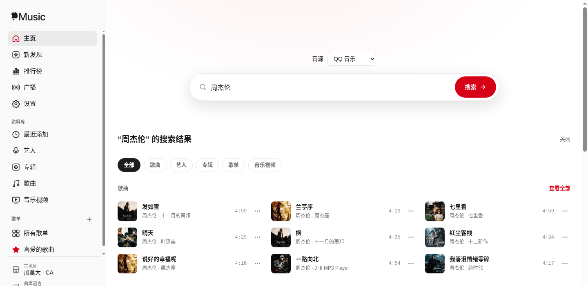
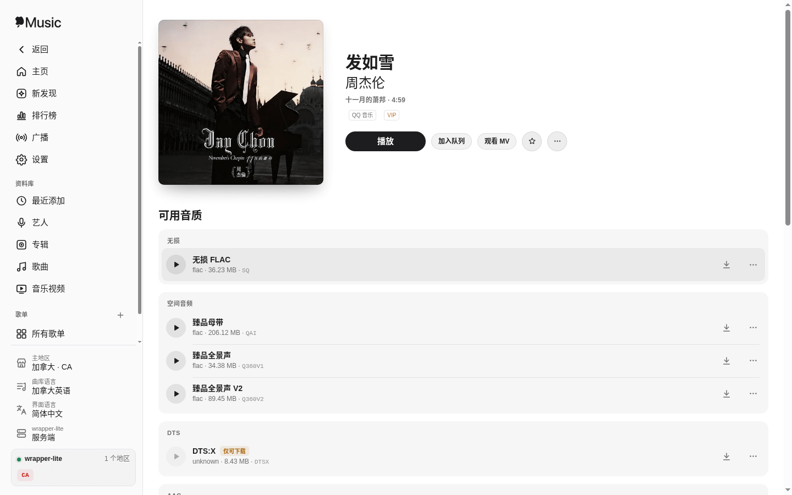
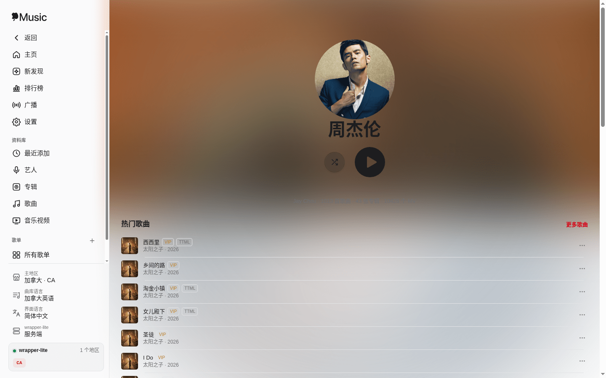

<div align="center">

# Fantastic

**浏览器里的音乐网页播放器：Apple Music 与 QQ 音乐同在一个播放器——无损、杜比全景声与 MV，全部由 WebAssembly 在本地解密。**

[](https://github.com/itouakirai/am-hook/releases/latest)
[](https://github.com/itouakirai/am-hook/actions/workflows/build-test.yml)
[](LICENSE)
[](https://t.me/apple_music_alac)
[](https://qun.qq.com/universal-share/share?ac=1&authKey=1ao3fc9n1aN4ese64QmDs6mOZgvdB7YfR1K9y0YncbQp1%2Bz61x3EKfMCROv9MHhv&busi_data=eyJncm91cENvZGUiOiI2NzgwMzg1NDgiLCJ0b2tlbiI6IkJrWmNuZUt6bjAwcDFEWFZxN3FRQlNUeWhyd21BbEU3RXBrbWl6VkpKMnAxeUI0WVhQd01rNThkSE9nU0ZGeU8iLCJ1aW4iOiIzMzE5NDA2NDMzIn0=&data=_3dZowj6FqunhT1cxI3F_NM2b8r-Cv1IYvqZQAG2z6TO-8baaR3Lj5UiKhuGOo3VvCLc9dp8F2-IfW7iTdoEyQ&svctype=4&tempid=h5_group_info)
[](https://discord.gg/xSqKAnpSxR)

中文 | [English](README.md)


</div>

Fantastic 是一个用 Rust 编写的音乐网页播放器，把 **Apple Music** 和 **QQ 音乐**放进同一个播放器：两边各自独立队列、共用播放条与歌词界面。网易云音乐（NCM）音源待开发。

在线体验：<https://music.1412.tech>

## 亮点

**通用**

- 与 music.apple.com 一致的单页应用：常驻播放条、无缝衔接、系统媒体控制，站内跳转播放不中断。
- 由 [AMLL](https://github.com/amll-dev/applemusic-like-lyrics) 渲染的逐字歌词与全屏播放界面，支持翻译与音译。
- 浏览器内的杜比全景声对象渲染（JOC），输出到立体声扬声器或双耳耳机。
- 本地资料库：资料库、歌单、喜爱与文件夹保存在浏览器 IndexedDB，可导入 / 导出。
- 界面支持简体中文、繁體中文与 English；单个二进制部署，或一键部署到 Vercel / Cloudflare。

**Apple Music**

- 全部音质：无损 ALAC（最高 24-bit / 192 kHz）、杜比全景声、AAC / HE-AAC / 双耳 / 缩混，以及最高 4K 杜比视界的 MV。
- **浏览器内解密**：服务端只与 wrapper-lite 通信，媒体由浏览器直连 Apple CDN，在 Web Worker 中用 WebAssembly 解密。
- 搜索、新发现、排行榜、广播与电台，专辑 / 歌单 / 艺人 / 编辑页；AutoMix 过渡。
- 批量下载（iTunes 标签、封面、歌词，ZIP / 文件夹 / 逐个文件，文件名模板）与 ALAC 缺陷检测。

**QQ 音乐**

- **搜索**：歌曲、专辑、歌手、歌单、MV 五类结果，输入时实时联想；在搜索页一键切换音源。
- **20 档音质**，按分组列出并显示文件大小，可逐档播放或下载：
  - 无损：Hi-Res、无损 FLAC；空间音频：臻品母带、臻品全景声（V1 / V2）、360 Reality Audio
  - 杜比全景声：AC-4（DA / AJOC 448 / AJOC 1500，浏览器支持时直接播放）、杜比 EAC3（经 JOC 管线在浏览器内渲染）
  - DTS 5.1 / DTS:X，以及 AAC、OGG、MP3 320 / 128 等常规档位
  - 首选音质不可用时自动按顺序降级
- **歌词**：按 AMLL 歌词库 → TTML → QRC → LRC 依次取用，逐字 QRC 含翻译与罗马音，可下载原始 QRC / 翻译 / 注音。
- **完整页面**：歌曲详情（发行时间、流派、语种、唱片公司、碟号曲序、简介）、专辑、歌手（热门歌曲、专辑、MV 分页）、歌单与 MV 播放页。
- **隐私与安全**：QQ API 地址只存在于服务端（`--qq-api`），浏览器不直接访问；播放为 302 跳转、媒体由浏览器直连 QQ CDN，下载经服务端白名单转发。

## 截图

**QQ 音乐**

<table>
  <tr>
    <td width="50%"></td>
    <td width="50%"></td>
  </tr>
  <tr>
    <td align="center">搜索</td>
    <td align="center">音质选择</td>
  </tr>
  <tr>
    <td width="50%"></td>
    <td width="50%"></td>
  </tr>
  <tr>
    <td align="center">逐字歌词</td>
    <td align="center">歌手页</td>
  </tr>
</table>

**Apple Music**

<table>
  <tr>
    <td width="33%"></td>
    <td width="33%"></td>
    <td width="33%"></td>
  </tr>
  <tr>
    <td align="center">专辑</td>
    <td align="center">艺人</td>
    <td align="center">排行榜</td>
  </tr>
</table>

## 快速开始

从 [Releases](https://github.com/itouakirai/am-hook/releases/latest) 下载 Windows / Linux / macOS 的预编译二进制，或自行构建：

```sh
cargo build --release

# Apple Music：需要运行中的 wrapper-lite（默认 http://127.0.0.1:12340）
# QQ 音乐（可选）：--qq-api 指向 QQ API，也可用环境变量 FANTASTIC_QQ_API
fantastic --listen 0.0.0.0:8888 \
  --wrapper-url http://127.0.0.1:12340 \
  --qq-api https://example.invalid/api/web
```

浏览器打开 `http://127.0.0.1:8888/`，粘贴 Apple Music 链接或直接搜索。也可以把链接拼在地址后面直接打开，如 `http://127.0.0.1:8888/https://music.apple.com/cn/album/...`。

- 不想运行二进制：可一键部署到 [Vercel / Cloudflare](docs/guide.zh-CN.md#serverless-部署vercel--cloudflare)（不含 QQ 音源）。
- 没有服务端 wrapper-lite：页面可切换为[本地 wrapper-lite](docs/guide.zh-CN.md#使用本地-wrapper-lite)，由浏览器直接请求。
- QQ 音源的代理、请求路径与歌词格式见 [QQ 音源规格](docs/qq-source-validation.md)与 [QQ 音质规格](docs/qq-quality-validation.md)。

## 文档

完整说明移到了 [docs/guide.zh-CN.md](docs/guide.zh-CN.md)：

- [运行环境与链接格式](docs/guide.zh-CN.md#运行环境)
- [部署（Serverless、本地 wrapper-lite、QQ 音源）](docs/guide.zh-CN.md#部署)
- [使用指南（播放器、歌词、MV、电台、资料库、下载）](docs/guide.zh-CN.md#使用指南)
- [工作原理](docs/guide.zh-CN.md#工作原理)
- [命令行参数与服务端接口](docs/guide.zh-CN.md#参考)
- [构建、测试与项目结构](docs/guide.zh-CN.md#开发)

## 交流群

使用问题、反馈与讨论：Telegram 群组 [@apple_music_alac](https://t.me/apple_music_alac)。AMLL 社区（Fantastic 内嵌的歌词库）在 QQ 群 [AMLL 亲友团](https://qun.qq.com/universal-share/share?ac=1&authKey=1ao3fc9n1aN4ese64QmDs6mOZgvdB7YfR1K9y0YncbQp1%2Bz61x3EKfMCROv9MHhv&busi_data=eyJncm91cENvZGUiOiI2NzgwMzg1NDgiLCJ0b2tlbiI6IkJrWmNuZUt6bjAwcDFEWFZxN3FRQlNUeWhyd21BbEU3RXBrbWl6VkpKMnAxeUI0WVhQd01rNThkSE9nU0ZGeU8iLCJ1aW4iOiIzMzE5NDA2NDMzIn0=&data=_3dZowj6FqunhT1cxI3F_NM2b8r-Cv1IYvqZQAG2z6TO-8baaR3Lj5UiKhuGOo3VvCLc9dp8F2-IfW7iTdoEyQ&svctype=4&tempid=h5_group_info)（群号 678038548）与 [Discord](https://discord.gg/xSqKAnpSxR)。Bug 与功能建议仍欢迎提交到 [Issues](https://github.com/itouakirai/am-hook/issues)。

## 许可证

Fantastic 以 [GNU Affero 通用公共许可证 v3.0（仅此版本）](LICENSE)（AGPL-3.0-only）发布，因为 Web 界面内嵌了以 AGPL 授权的 [AMLL](https://github.com/amll-dev/applemusic-like-lyrics) 歌词播放器。如果将修改后的版本作为网络服务运行，需要向其用户提供对应的源代码。

内置的第三方组件保留各自的许可证：`crates/temari`（MIT）、hls.js CEA-608 解析器（Apache-2.0，`browser/cea608/LICENSE`）、`@mediabunny/ac3`（MPL-2.0，`src/ui/EC3-LICENSE.txt`）、AMLL 及其依赖（AGPL-3.0-only，`browser/amll`）、来自 am-hook-joc 的 JOC 渲染器（AGPL-3.0-only 或 MIT，`crates/joc-core/LICENSE`）、来自 YouLyPlus 的歌词封面背景（MIT，声明见 `src/ui/lyrics/backdrop-render.mjs`），以及 SADIE II HRTF 场（Apache-2.0，见 `src/ui/JOC-NOTICE.md`）。
